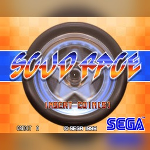

<p align="center"></p>

# scudrace-nx

**Scud Race** on the Nintendo Switch: [wanszai's Xbox 360 build](https://github.com/wanszai/Scud-Race) of Sega's
1996 Model 3 racer (release **0.0.17**), statically recompiled to native Switch code with the ReXGlue SDK and drawn by
the Renut renderer on deko3d. It is built on [mk9-nx](https://github.com/Thorhax/mk9-nx).

**This repository and its releases hold no game data.** You need wanszai's Xbox 360 package and your own ROM set. No
game files, ROMs, or code generated from them are committed or published.

## What you need

| File | Where it comes from |
|---|---|
| `default.xex`, `default.map`, `ui/`, `icon.png`, `online.ini` | `ScudRace-X360.zip` from [wanszai/Scud-Race release 0.0.17](https://github.com/wanszai/Scud-Race/releases/tag/0.0.17), unchanged. The port is that exact build: no other release works |
| `scud.zip` | Your own Scud Race ROM set, the **parent program revision** (program ROMs `epr-19688.17`-`epr-19691.20`; MAME's `scuda` set renamed works). Clone revisions are refused by the game. See wanszai's README for the expected file |
| `dayto2pe.zip` (optional) | Your own Daytona USA 2 Power Edition ROM set: the game builds the hidden JOYPOLIS course from it |

The game writes `scud_mpeg.bin` itself on the first start.

## Install

1. Download `scudrace-nx.nro` from the [latest release](../../releases/latest).
2. On the SD card, make this layout:

   ```
   /switch/scudrace-nx/scudrace-nx.nro
   /switch/scudrace-nx/game_root/default.xex      (and default.map, ui/, icon.png, online.ini from ScudRace-X360.zip)
   /switch/scudrace-nx/game_root/scud.zip
   /switch/scudrace-nx/game_root/dayto2pe.zip     (optional)
   ```

3. Start it from the Homebrew Menu opened **through a game** (hold R while starting any game): the port needs the
   full memory, which the album applet does not give.

The first start after installing is a few seconds slower: the port keeps the menus' decoded pictures in
`/switch/scudrace-nx/cache/`. Your settings file `scud.toml` is written next to the NRO.

## Playing

- **Quick menu: Minus + Plus.** Resume game, Cheats (Unlimited time, Always first place), Return to the main menu, and
  Exit game (it saves first). Cheat changes are saved to `scud.toml`.
- **16:9:** OPTIONS > VIDEO SETTINGS > SCREEN in the game's own menu.
- **Saving:** the game saves its options and records when you leave through EXIT, the quick menu's Exit game, or
  HOME > Close (the port lets the game save before it closes).
- **Buttons:** the face buttons go by letter, as in other Switch games (A confirms, B goes back). Put
  `input_xbox_layout = true` in `scud.toml` to go by position instead, as on the Xbox 360 pad the game was made for
  (the bottom button, B, confirms; 1.0.0's default).
- **Gear buttons:** buttons bound to single gears (Gear 1-4 in the game's controls menu, say Gear 2 on D-pad up) work
  only with the gear shifting set to **H type**, the game's own rule: in sequential mode only shift up / down count.
- Skip the Thorhax intro with any button after 3 seconds, or Minus + Plus at any time.

## Performance

Measured on the console, Expert course at 16:9, 60-second race:

| CPU clock | Frames per second |
|---|---|
| 1020 MHz (stock) | ~51 average |
| 1785 MHz | 59.9 average, no long frames |

The game runs at the Model 3 board's own rate of 57.5 updates per second. From power-on to the title takes about
10 seconds (16 before the boot work: the ROMs are unpacked by native code, and the menus' pictures are cached).

## Known issues

- **Always first place** shows your real position on the race HUD at times, but the result counts you as first.
- About 7 seconds of the boot are the emulated board's own start-up (its sound board wait and graphics self-test),
  left as they are.

## Building

See [`docs/building.md`](docs/building.md). The port's working notes, with every measurement, are in
[`docs/scud-notes.md`](docs/scud-notes.md).

## Credits

- **wanszai**, for the Xbox 360 build of Scud Race this port runs.
- **Sega AM2**, for Scud Race.
- The ports and tools this one is built on: see [`THIRD_PARTY_NOTICES.md`](THIRD_PARTY_NOTICES.md) (mk9-nx, usf4-nx,
  sa2-nx, masseffect-nx, nfsmw-nx, the ReXGlue SDK, reNut, banjo-nx, deko3d and more). The quick menu follows
  Shaolin Monks NX's (from NaGa's Dolphin NX frontend via YabaSanshiro NX).

## License

GPL-3.0 (`LICENSE`), with the SDK under BSD-3-Clause; see `THIRD_PARTY_NOTICES.md`.
